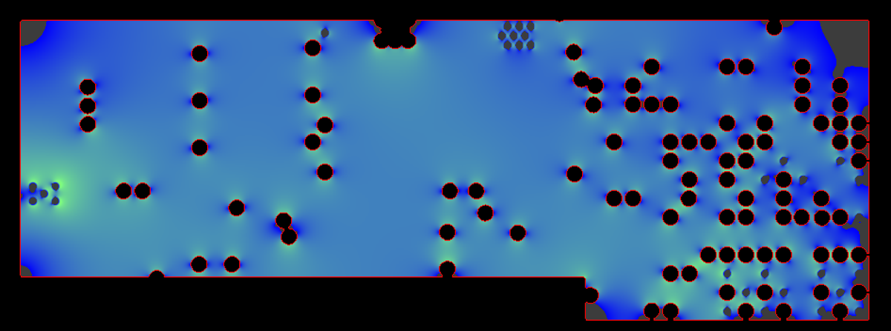

# kicad-irdrop

DC voltage drop of a power net on a KiCad board, solved on the board's real copper: filled pours, tracks, pads and
the barrel of every via.

## Example: an open-source board

[Antmicro's LPDDR4 test board](https://github.com/antmicro/lpddr4-test-board) (Apache-2.0; commit 5c8b5d3): an 8-layer Kintex-7 FPGA board with an LPDDR4 SO-DIMM socket. Its FPGA core rail, 1V0_SYS, comes from a buck converter through a 0 ohm link, R147, and feeds 17 balls of
the FPGA, U3. Solved for 2 A:

```bash
git clone https://github.com/antmicro/lpddr4-test-board && cd lpddr4-test-board
python3 -m kicad_irdrop lpddr4-test-board.kicad_pcb --rail 1V0_SYS:R147:2:U3::1.0 --maps maps/
```

```
1V0_SYS: 2 A from R147 to U3 | worst 5.3 mV at U3.J15, median 5.0 mV, R_eff 2.67 mOhm | budget 20.0 mV: ok
  vias 32; 0 barrel segments over their IPC-2221 rating; busiest: 0.45 A @(128.183,93.35) In5.Cu-In6.VCC, 0.45 A @(128.183,93.35) In4.VCC-In5.Cu, 0.45 A @(128.183,93.35) In1.GND-In2.Cu
  peak current density 56 A/mm2 on F.Cu at (127.91,93.42)
  loss by location: via@128.18,93.35 3%, via@128.18,94.15 3%, F.Cu@127,93 3%, via@128.78,93.75 2%, via@129.38,93.35 2%, via@129.38,94.15 2%
```

2.7 mOhm and 5 mV at 2 A: a healthy rail. No via is over its rating and the loss is spread out, with no single neck
taking more than 3 %. Halving the grid (`--grid 0.025`) moves the result by about 1 %. The map of the inner-layer
pour that carries most of the current, from `--maps` (blue low, red high):



## Why we wrote it

We were signing off an 8-layer board with a chip-down SoC. Our first power check walked the copper graph and rated
each track: it reported about 15 A of capacity and about 1 mOhm from inductor to balls on the CPU rail, so we called
the power delivery fixed. A reviewer did not believe it, and they were right. That check treated every pour and every
via as a perfect conductor. Solving the same copper as a resistive mesh gave 10 mOhm, 30 mV of drop at 3 A against a
20 mV budget, and one via carrying half of the rail's current. The DDR supply was 38 mOhm. None of that was visible
until the via barrels and the pour shapes were in the model.

kicad-irdrop is that mesh solve, cleaned up and made generic.

## What it does

- Rasterises every copper layer of the net (pours as filled, tracks, arcs, pads) on a grid; neighbouring cells are
  joined by the sheet conductance of that layer's copper, taken from the board's own stack-up.
- Models each via as a chain of barrel segments between the layers it spans: a plated tube (wall thickness
  `--plating`, default 20 um), or a solid cylinder for laser microvias or `--filled-vias`. Each barrel is tied to the
  whole ring on each layer, so it is never a point contact and the answer converges as the grid gets finer.
- Holds the source part's pad at 0 V and draws the current equally from every pad of the load parts.
- Reports the worst and median drop, the effective resistance, and, with a sense part, the drop the load actually
  sees once the regulator regulates at its feedback point.
- Lists the busiest via barrels against an IPC-2221 internal-conductor rating (10 C rise), the peak current density,
  and where the loss is (1 mm bins per layer, and per via), which tells you which neck or via to fix.
- Optional per-layer current-density PNG maps (`--maps`, needs Pillow) and JSON output.

## Install and run

It needs KiCad's `pcbnew` module, so run it with the Python that ships with KiCad (KiCad 8 or newer; developed on
KiCad 10).

```bash
"/Applications/KiCad/KiCad.app/Contents/Frameworks/Python.framework/Versions/Current/bin/python3" -m pip install git+https://github.com/firedanceio/kicad-irdrop
```

```bash
"/Applications/KiCad/KiCad.app/Contents/Frameworks/Python.framework/Versions/Current/bin/python3" -m kicad_irdrop board.kicad_pcb --rail VDD_CORE:L3:3:U1:R12:0.9 --maps out/
```

On Linux and Windows use the KiCad Python on your path (`python3` from the KiCad install, or the KiCad command
prompt). Fill the zones before you run it (KiCad: Edit > Fill All Zones, then save).

Rail spec: `NET:SOURCE:AMPS[:LOAD1+LOAD2[:SENSE[:VNOM]]]`

| Field | Meaning |
|---|---|
| NET | the power net |
| SOURCE | reference of the part feeding it: the buck's inductor, an LDO |
| AMPS | total load current |
| LOADS | load part references joined with `+` (default `U1`) |
| SENSE | the regulator's feedback point, e.g. the top resistor of its divider (optional) |
| VNOM | nominal voltage, for the `--budget-pct` check (default 2 %) |

Exit status: 0 all rails within budget (or no budget given), 1 a rail over budget, 2 an error.

## Checking the answer

Halve `--grid` and run again: the effective resistance should move by well under 10 %. If it moves more, a thin
feature (a 0.1 mm neck, a via landing) dominates the path, and the finer grid is the one to trust.

## Limits

DC only: no inductance, no capacitors, no transient droop. Copper at 20 C, no solder or package resistance, equal
current per load pad. Use it to compare layouts and find bottlenecks, then confirm on the bench (drop and load-step
measured at the load's decoupling capacitors).

## License

Apache 2.0. Made by [Firedance](https://firedance.io).
