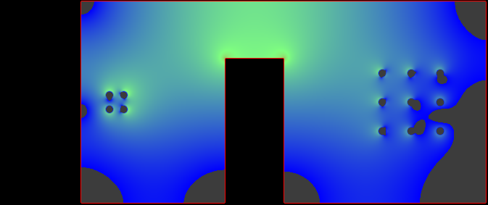
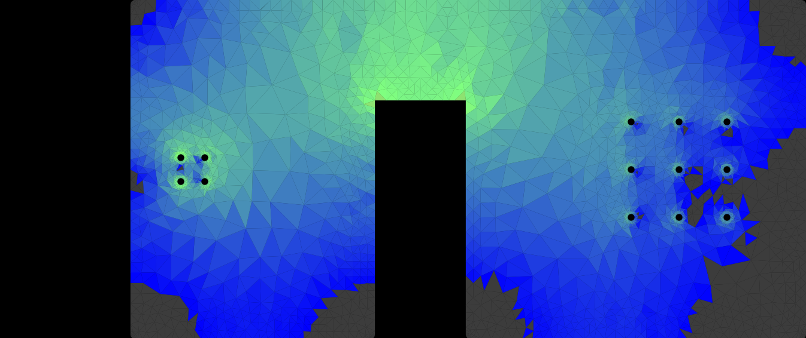

# Cross-check against padne

[padne](https://github.com/atx/padne) is an independent open-source DC solver for KiCad boards: a finite-element
mesh where kicad-irdrop uses a grid. Solving the same copper with both is a check on the mesh, the via model and
the stack-up handling, without trusting either tool on its own.

## The board

`make_xcheck_board.py` builds a 4-layer board in KiCad: a source pad J1, a track (the neck), a 2x2 via cluster
down to a PWR pour on In2.Cu with a notch the current has to go around, and a 3x3 load U1 on a 2 mm grid, each pad
on a short track to its own via. In1.Cu is a full GND plane. It takes any KiCad 8 4-layer board as the template for
the stack-up; we used padne's own `tests/kicad/via_tht_4layer` (35 um copper, 0.1 mm prepreg, 1.24 mm core).

Both tools were set to the same copper: conductivity 5.8e7 S/m (`!padne COPPER conductivity=5.8e7`) and 25 um via
plating (`--plating 0.025`). padne draws 2 A from the nine load pads through 10 ohm coupling resistors, which forces
the same near-equal split per pad that kicad-irdrop uses.

## Results (2 A, padne 0.3, kicad-irdrop 0.1.0)

| Case | Tool | Worst drop | Median drop | Drop / current |
|---|---|---|---|---|
| 0.5 mm neck (the track dominates) | padne | 12.23 mV | 12.18 mV | 6.08 mOhm |
| | kicad-irdrop, 0.025 mm grid | 12.21 mV | 12.17 mV | 6.11 mOhm |
| 3.0 mm neck (vias and pour dominate) | padne | 6.01 mV | 5.96 mV | 2.97 mOhm |
| | kicad-irdrop, 0.025 mm grid | 6.1 mV | 6.0 mV | 3.04 mOhm |

The two agree within 0.5 % when the neck dominates and within about 2.5 % when the vias and the notched pour carry
the loss. Both put the peak current density at the notch corner.

## Side by side

The PWR pour on In2 with a 3.0 mm neck, both drawn on kicad-irdrop's colour scale (log of current density, blue at
1 A/mm2 or below, red at 316 A/mm2; grey is copper carrying under 1 A/mm2). padne's map is drawn from its exported
mesh with `padne_map.py`.

<table>
<tr><th>kicad-irdrop (0.05 mm grid)</th><th>padne 0.3 (finite-element mesh)</th></tr>
<tr><td></td>
<td></td></tr>
</table>

Both show the current crowding over the notch, the quiet corners, and the via fields at the source (left) and load
(right).

## Reproduce

```bash
KPY="/Applications/KiCad/KiCad.app/Contents/Frameworks/Python.framework/Versions/Current/bin/python3"
"$KPY" make_xcheck_board.py padne/tests/kicad/via_tht_4layer/via_tht_4layer.kicad_pcb out 3.0
"$KPY" -m kicad_irdrop out/xcheck.kicad_pcb --rail PWR:J1:2:U1 --plating 0.025 --grid 0.025
```

For padne, copy `via_tht_4layer.kicad_pro` to `xcheck.kicad_pro`, write a schematic `xcheck.kicad_sch` holding three
text items:

```
!padne CURRENT i=2A f=U1.1,U1.2,U1.3,U1.4,U1.5,U1.6,U1.7,U1.8,U1.9 t=J1.1 coupling=10
!padne VOLTAGE v=1.0V p=J1.1 n=G1.1
!padne COPPER conductivity=5.8e7
```

and give padne the board in KiCad 8 syntax (padne 0.3's bundled KiCad does not read a KiCad 10 file):

```bash
python3 to_kicad8.py padne/tests/kicad/via_tht_4layer/via_tht_4layer.kicad_pcb out/xcheck.kicad_pcb padne-run/xcheck.kicad_pcb
padne solve padne-run/xcheck.kicad_pro sol.pickle && padne paraview sol.pickle vtu
python3 padne_drops.py vtu/F.Cu.vtu
```

We ran padne's Linux release binary in a Docker container. On the two Antmicro example boards in the main README,
padne 0.3 stopped at its meshing step, so this purpose-built board is where the two are compared.
